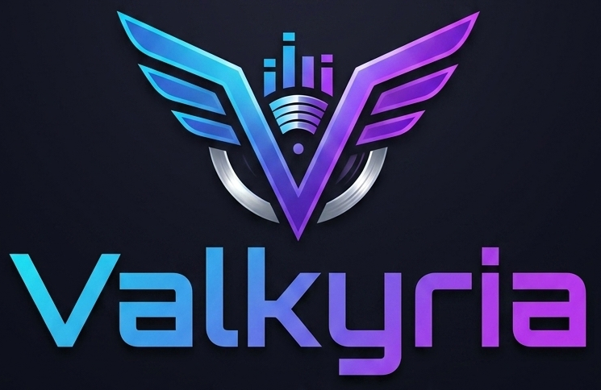

<p align="center">
  
</p>

A simple audio player which supports playlist management and browsing
local audio files.

## Features

Valkyria features include:

-   Play audio files (MP3, WAV, FLAC, OGG, M4A).
-   Load single files, multiple files, or playlists (M3U / M3U8).
-   Browse folders to add multiple songs in the playback list.
-   Playback controls: Play, Pause/Resume, Stop, Previous, Next.
-   Automatic next track playback.
-   Metadata display and editing.
-   Metadata album images booklet
-   Save playlists (Save / Save As).

For the full list of the available features please refer to the user guide documentation (link below).

## Supported Formats

-   MP3
-   WAV
-   FLAC
-   OGG
-   M4A / AAC

## Installation

### Download a release (recommended)

Ready-to-run installers are attached to each
[GitHub Release](https://github.com/mchimento/Valkyria/releases/latest) —
no Python needed. Download the file for your platform from the **Assets**
section of the latest release:

| Platform | File | How to install |
|----------|------|----------------|
| Windows 10/11 (64-bit) | `ValkyriaSetup-<version>.exe` | Run the installer and follow the wizard. |
| Linux (x86_64) | `Valkyria-<version>-linux-x86_64.zip` | Unzip, then run `./install_appimage.sh` (adds Valkyria to your app menu). |

**Windows:** the installer is not yet code-signed, so Windows SmartScreen
may show "Windows protected your PC". Click **More info → Run anyway**.

**Linux:** the zip contains the AppImage plus `install_appimage.sh` and
`uninstall_appimage.sh`. Running the `.AppImage` directly also works
without installing, but it won't appear in your app menu. If it doesn't
start, make sure it's executable (`chmod +x Valkyria-*.AppImage`).

**Verifying your download (optional):** each release includes a
`SHA256SUMS.txt`. Compare it with your file's hash:

``` bash
# Linux
sha256sum -c --ignore-missing SHA256SUMS.txt
```

``` powershell
# Windows (PowerShell) — compare the output with SHA256SUMS.txt
Get-FileHash .\ValkyriaSetup-<version>.exe -Algorithm SHA256
```

### Building installers

To build the installers yourself instead of downloading them:

Instead of running from source, you can generate a standalone installer
for your platform — no Python, venv, or this repo needed on the machine
that ends up running the app:

``` bash
# Windows: builds a Valkyria.exe installer (Inno Setup)
packaging\windows\build_installer.bat

# Linux: builds a portable Valkyria AppImage
packaging/linux/appimage/build_appimage.sh
```

The Windows script sets up its own Python virtual environment and
installs dependencies automatically on first run, so it works even if
you've never set up a venv before. See
[packaging/README.md](packaging/README.md) for prerequisites (Inno Setup
on Windows, `appimagetool` on Linux) and the raw-binary/manual-install
flow for Linux dev machines.

### From source code

1.  Install Python 3.12 or later.
2.  Install Python dependencies:

``` bash
pip install -r requirements.txt
```

## Usage

1.  Launch the app:

    If you installed Valkyria from a release download or one of the
    generated installers (see [Installation](#installation) above), launch it
    directly — via the Start Menu shortcut / desktop icon on Windows, or
    by running the `.AppImage` file on Linux — no Python needed.

    If you're running from source instead, run:

``` bash
python main.py
```

2.  Use the File menu to open files, multiple files, playlists, or
    folders.
3.  Select songs in the browser (right list) and click `Add ->` to add
    them to the playlist.
4.  Use the playback controls to play, pause, stop, or navigate tracks.
5.  Save your playlist using `Save` or `Save As` from the File menu.
6.  Remove songs from either list by selecting them and pressing the
    `Delete` key.

## Dependencies

-   Python 3.12+
-   PySide6
-   sounddevice
-   soundfile
-   numpy
-   scipy
-   mutagen
-   librosa

## File Structure

-   `main.py`: Entry point for the application.
-   `app/`: Core application logic and state management.
-   `ui_qt/`: User interface components (windows, views, controls).
-   `audio/`: Audio playback handling.
-   `themes/`: Theme definitions and management.
-   `README.md`: Documentation for the tool.

## Documentation

Comprehensive documentation is available within the application and in the `docs/` folder:

### User Guide
Complete guide covering all features, controls, and workflows. Access via **Help → Documentation → User Guide** in the application, or view the file directly here: [User Guide](docs/user_guide.md).

### BPM Analysis
Detailed technical documentation about the automatic tempo detection system. Access via **Help → Documentation → BPM Analysis** in the application, or view the file directly here: [BPM Analysis](docs/bpm_analysis.md).


## Troubleshooting

### MP3/MP4 files don't show waveforms or display ffmpeg warnings

**Symptoms:**
- No waveform appears in the seekbar for MP3/MP4 files
- Warning message: `Couldn't find ffmpeg or avconv - defaulting to ffmpeg, but may not work`

**Cause:**
MP3 and MP4 are compressed formats that require the `ffmpeg` codec for decoding. If ffmpeg is not installed or not accessible, these files cannot be processed.

**Solution:**
Install ffmpeg for your operating system:

**Windows:**
```bash
choco install ffmpeg
```
Or download directly from [ffmpeg.org](https://ffmpeg.org/download.html)

**Linux:**
```bash
sudo apt-get install ffmpeg
```

**macOS:**
```bash
brew install ffmpeg
```

**Important:** After installing ffmpeg, **restart the application** for PATH changes to take effect.

**Verify installation:**
```bash
ffmpeg -version
```

If the command returns version information, ffmpeg is correctly installed and accessible.

## License

See the LICENSE file for details.
